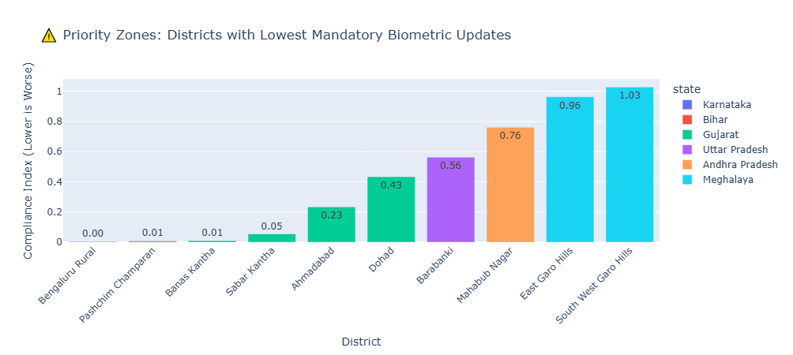
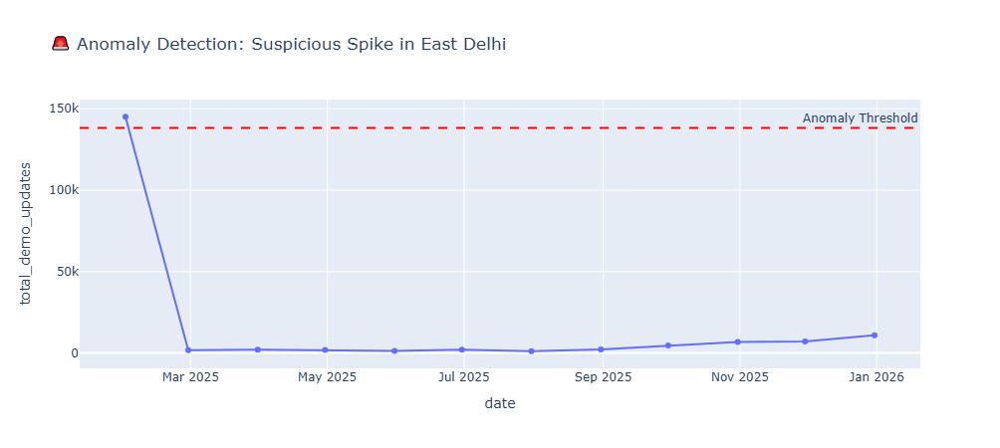
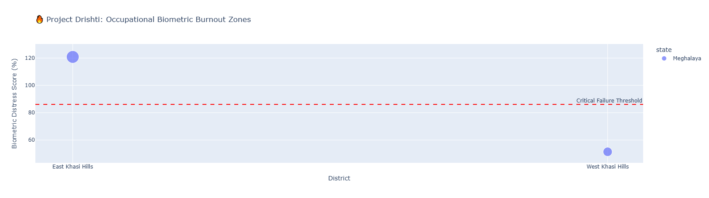
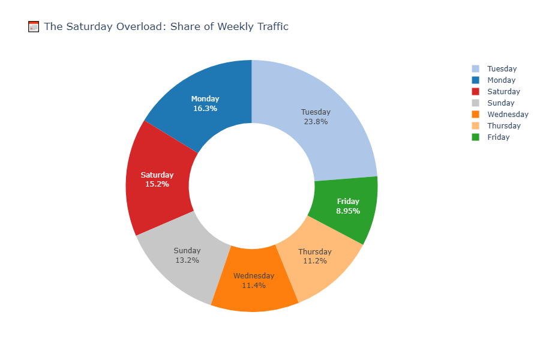
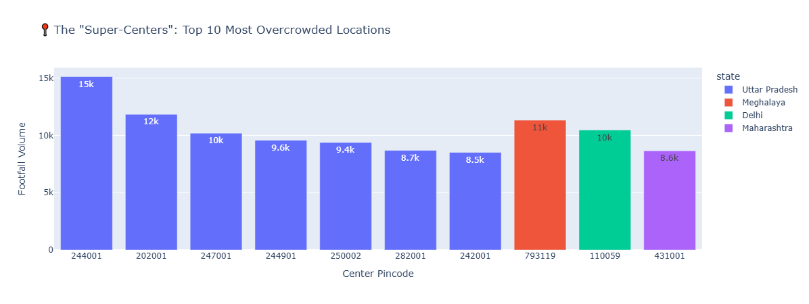
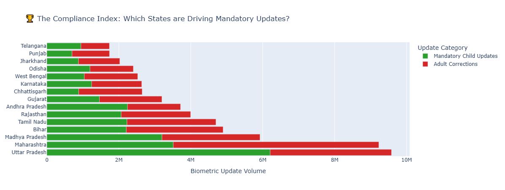
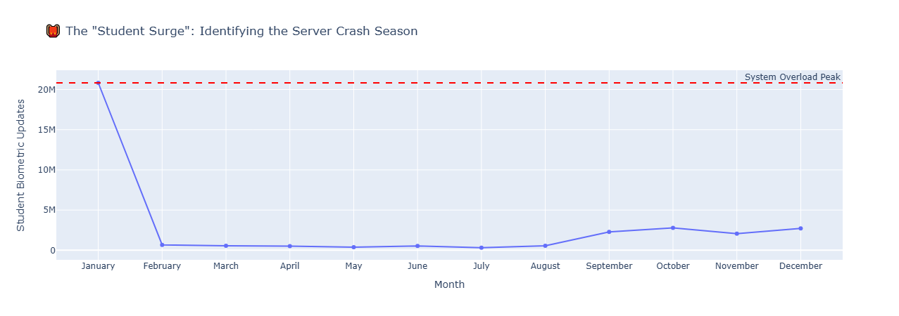

<h1 align="center">👁️ Project Drishti — Aadhaar Operations Analytics</h1>

<p align="center"><b>Spatiotemporal analysis of ~4.9 million aggregated Aadhaar enrolment, demographic-update and biometric-update records to find service bottlenecks, unusual spikes and districts that need more capacity.</b></p>

<p align="center">
  
  
  
  
  
  <a href="LICENSE"></a>
</p>

<p align="center">
  
</p>

> **Team project** — Swarangi Kothawade & Suraj Madane · UIDAI & MeitY Hackathon 2026 (Team ID UIDAI_4318) · Theme: *Data-Driven Innovation for Aadhaar*.
> Full submission: [UIDAI_TeamId_4318.pdf](UIDAI_TeamId_4318.pdf)

---

## 📌 Problem statement

Aadhaar centres see uneven demand: some districts and pincodes are overloaded, mandatory child biometric updates are missed in some regions, and sudden spikes in updates can signal either special drives or irregular activity. The goal was to turn the hackathon's aggregated operational datasets into **evidence for where to add capacity and what to investigate**.

## 🎯 Objectives

1. Merge and clean the three datasets (enrolment, demographic updates, biometric updates).
2. Measure regional compliance with mandatory child biometric updates.
3. Detect statistically unusual monthly spikes per district.
4. Find the busiest pincodes and the seasonal and weekly demand patterns.
5. Translate findings into operational proposals.

---

## 📊 Data

| Dataset | Rows | Columns |
|---|---:|---|
| Enrolment | 1,006,029 | date, state, district, pincode, age_0_5, age_5_17, age_18_greater |
| Demographic updates | 2,071,700 | date, state, district, pincode, demo_age_5_17, demo_age_17_ |
| Biometric updates | 1,861,108 | date, state, district, pincode, bio_age_5_17, bio_age_17_ |

The data are **aggregated counts per pincode and day** provided to hackathon participants — no individual records. The raw CSV folders are excluded from the repository (`.gitignore`); place them next to the notebook to re-run it.

---

## 🔬 Analyses (all in [`1_data_merging.ipynb`](1_data_merging.ipynb))

| # | Analysis | Method |
|---|---|---|
| 1 | **Compliance gap** | Ratio of child biometric updates (5–17) to child enrolments (0–5) per district; lowest 10 districts |
| 2 | **Anomaly spikes** | Monthly demographic updates per district, Z-score against each district's own mean and standard deviation |
| 3 | **Demand forecast** | National monthly enrolments with a 3-month moving average as a next-month baseline |
| 4 | **Biometric distress ratio** | Adult biometric updates relative to adult enrolments per district, to flag possible fingerprint-quality problems |
| 5 | **Student surge** | Month-of-year pattern of child biometric updates |
| 6 | **Seasonal impact** | Monthly enrolments in a flood-prone state (Assam) |
| 7 | **Weekly load** | Share of enrolments by weekday |
| 8 | **Super-centres** | Top 10 pincodes by total enrolments |
| 9 | **Compliance index** | State-level mandatory child updates vs adult corrections |

---

## 🖼️ Visual results

| Anomaly spikes | Biometric distress zones |
|:---:|:---:|
|  |  |
| **Weekly load** | **Busiest pincodes** |
|  |  |
| **Compliance index** | **Student update pattern** |
|  |  |

Example outputs recorded in the notebook:

- **Busiest pincode:** 244001 (Moradabad, Uttar Pradesh) with 15,122 enrolments in the dataset period.
- **Largest spike:** East Delhi, January 2025 — 145,128 demographic updates against a monthly mean of about 15,588.
- **Student updates** are heavily concentrated in January (20.8 M of the year's child biometric updates).
- **Next-month enrolment baseline** (3-month moving average): 831,124.

---

## 💡 Proposals from the submission

These are recommendations made for the hackathon, **not measured outcomes**:

- Extra weekend capacity and mobile units for the busiest districts and pincodes.
- Targeted child-update drives in the lowest-compliance districts.
- Iris-capable devices where the biometric distress ratio is highest.
- Review of districts with extreme update spikes.

The submission PDF also includes a cost and impact estimate and a migration hypothesis; those are illustrative assumptions, not results derived from this data.

---

## 🚀 Reproduce

```bash
git clone https://github.com/SwarangiK-21/UIDAI-Hackathon-2026.git
cd UIDAI-Hackathon-2026
pip install pandas numpy plotly kaleido jupyter
# put the hackathon CSV folders here:
#   api_data_aadhar_enrolment/  api_data_aadhar_demographic/  api_data_aadhar_biometric/
jupyter notebook 1_data_merging.ipynb
```

## 📂 Project structure

```
UIDAI-Hackathon-2026/
├── 1_data_merging.ipynb      # Merge, clean, analyse, plot (all steps)
├── Plots/                    # Final charts used in the submission
├── Output/                   # Earlier chart versions
├── UIDAI_TeamId_4318.pdf     # Submitted report
└── LICENSE
```

## ⚠️ Limitations

- Counts are aggregated, so the analysis cannot separate individual behaviour from reporting artefacts.
- The forecast is a moving-average baseline, not a trained time-series model.
- The **migration treemap and trade-migration charts are drawn from values typed into the notebook** (cells 6 and 9), not computed from the datasets; treat them as illustrations.
- The distress ratio is a proxy; it has not been validated against actual authentication-failure data.

## 🔭 Future enhancements

- Proper time-series forecasting (seasonal models) with back-testing.
- Validate the distress ratio against authentication-failure rates if such data becomes available.
- Split the notebook into reusable scripts and an interactive dashboard.
